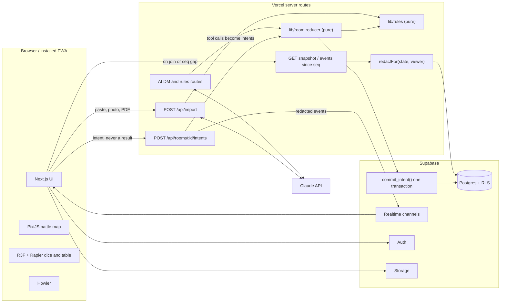

# Tavern Table: Phase 0 Plan

"Tavern Table" is the working name. Written against the updated spec, `D&D Companion Website — Agent Prompt (1).pdf`, which replaces the first version.

Status: **waiting for approval**. Nothing is built yet.

## 1. Decisions needed

| # | Decision | Default if you don't answer | Needed by |
|---|---|---|---|
| 1 | **"Generate" a portrait.** Claude can't create images, so this needs a paid image service | Upload, crop and built-in art only; no generation | Phase 2 |
| 2 | **Anthropic API key (paid).** Import and Create with AI now come in Phase 3, not at the end | No AI calls until you approve. Phases 1 and 2 don't need it | Phase 3 |
| 3 | **AI model per feature.** Opus costs more than Sonnet (see section 9) | Ask you at Phase 3, with measured cost per import | Phase 3 |
| 4 | **Public or showcase-only repo** | Public, as the PDF's tip suggests (your templates are usually showcase-only) | First push |
| 5 | **Final name** | Keep the placeholder | Before launch |

You also need to create a Supabase project and Google and Discord OAuth apps by Phase 2. I'll give exact steps.

## 2. Spec check

**Fixed by this version:** the Battle Master conflict is gone. Non-SRD options are now user-entered homebrew, and the app's own data ships SRD text only.

**Issues still in the spec, and how I'll handle them:**

| Issue | Handling |
|---|---|
| Immutable rolls conflict with deleting an account (a normal requirement for a public platform) | Rolls point to a `campaign_members` row, and names live only on that row. Deleting an account clears the name, so the log shows "Deleted user" and no roll row changes. Campaigns are archived, never hard-deleted |
| "AC items" need DM approval, but picking up a shield or changing armor is normal play | Equipping or unequipping an **owned** item is session state, and it's logged. Adding or changing an item's stats needs approval |
| Players can edit current HP, so they could quietly heal themselves | Allowed, as specified. Every change goes in the audit log, and manual HP increases are flagged to the DM |
| Level-up wizard still says "maneuvers", which aren't in the SRD | They only appear if a homebrew subclass defines them |
| "8 characters covering every class at levels 1, 5, 11" doesn't add up | I'll do all 12 classes at all 3 levels (36), plus a multiclass and a companion (38). Phase 1 gets bigger as a result |
| The PDF says to play-test after Phase 4, but rooms moved to Phase 5 | Play-test after **Phase 5** |

**Automation has a limit.** All derived numbers will be calculated, and spells will be automated where they follow a structure (attack, save, damage, healing, condition). Unusual effects can't all be automated, such as Wish or illusions, so they show the text and the DM rules on them.

**Kael Ashford is no longer in the spec.** I'd keep him as a numbers-only test, because he proves a homebrew subclass runs through the same data format. His numbers checked out by hand last time.

**Confirmed in the official SRD PDF:**

- The current version is **5.2.1**, so the footer uses this exact wording:

```
This work includes material from the System Reference Document 5.2.1 ("SRD 5.2.1") by
Wizards of the Coast LLC, available at https://www.dndbeyond.com/srd. The SRD 5.2.1 is
licensed under the Creative Commons Attribution 4.0 International License, available at
https://creativecommons.org/licenses/by/4.0/legalcode.
```

- XP budget tables are included, so the encounter builder is legal.
- "Creating a Background" is included.
- There are 12 classes with one subclass each. A rough search finds 300+ stat blocks and 250+ spells.

**Data source:** there is no official machine-readable SRD. I'll start from `5e-bits/5e-database`, `src/2024/en` (MIT license). I haven't checked its accuracy, so Phase 1 begins with an audit against the PDF. D&D Beyond pages are never scraped.

**Plain-language text for 500+ SRD items is a large writing job.** Core rules and conditions are written in Phase 2, spells and monsters in Phase 9. Until then those entries show the official wording only.

## 3. Architecture



**Room state.** `room_state` is one JSON document with a version number, and clients have **no read access**. RLS can't hide fields inside JSON, so every read goes through `redactFor(state, viewer)`.

**Intent flow:**

1. Check membership and role.
2. Validate with a strict schema. Unknown fields are rejected, so a client can't slip in a `result`.
3. Run the pure reducer, with dice from `crypto.randomInt`.
4. Call `commit_intent()`, which in **one transaction** checks the version, then writes state, events, rolls and audit rows.
5. Broadcast the redacted events.

Dice are only returned after they are committed. If the version check fails, the reducer reruns. Those discarded dice were never saved or shown, so a retry can't be used to fish for a better roll.

**Channels.** Private, authorized through RLS on `realtime.messages`:

- `room:{id}:{epoch}:public`
- `room:{id}:{epoch}:dm`
- `room:{id}:{epoch}:user:{uid}`

**Why the epoch:** Supabase caches channel permissions for the whole connection, so a kicked user keeps receiving messages until their JWT expires. Kicking someone or transferring the DM role therefore moves the room to a new `epoch`. The old channel goes silent, and the kicked user fails the membership check on the new one.

**Reconnects.** Broadcast doesn't guarantee delivery. Every event has a `seq`, and a client that sees a gap or refreshes fetches the snapshot and missed events.

**3D dice:**

1. The server rolls and broadcasts the values, along with the player's throw vector (cosmetic only).
2. Each client simulates the throw silently in Rapier and records the frames.
3. The client relabels the die so the face that lands up shows the server's value, then plays the recording.

The physics is never nudged, so it looks natural, and every screen shows the right number even if the simulations differ slightly. The fast 2D mode shows the same server result. I'm writing this rather than using a dice library, since steering is the core requirement.

**Rules engine.** Every derived number is `{ value, parts: [{ label, value }] }`, so tooltips come straight from the math. Features are data, so homebrew and SRD content use the same code.

**Hidden tokens.** Tokens hidden by the DM, under fog, or out of line of sight are never sent to players. `lib/map/visibility.ts` is pure and runs on server and client.

**AI DM.** Tool calls become ordinary intents with the actor `ai_dm`, limited to an allowlist. The AI never rolls and never changes state directly.

### Where I'd use something simpler than the spec's wording

| Spec item | Approach | Upgrade if |
|---|---|---|
| Printable PDF sheet | Print stylesheet and the browser's Save as PDF | You need one-click file generation |
| Installable PWA | `app/manifest.ts` and a minimal service worker, no offline play | You want offline sheets |
| Text-to-speech | Browser `speechSynthesis`: free, quality varies | You approve a paid voice service |
| Guest mode | localStorage, plus Supabase anonymous sign-in to join rooms. No AI features for guests, because each call costs money | Never, probably |

## 4. Anti-cheat design (top priority)

### Rolls

- **Intents only.** A client asks for a roll (`{ kind: "skill", skill: "athletics" }`) and the server does the rest.
- **Modifiers from the server.** Numbers come from the rules engine and the **session copy** of the character, held in server state. Editing the character in the library or by another route doesn't affect the session.
- **Typed rolls can't pass as checks.** `/roll 1d20+20` is allowed but labeled **TYPED** in the feed.
- **Player-added extras are labeled.** A situational bonus such as Bless, or claiming advantage the engine didn't calculate, is marked **PLAYER-ADDED**, with its source.
- **Visibility is set when the roll is committed:**

| Level | Who gets the values | Others see |
|---|---|---|
| Public | Everyone | Full dice |
| To DM only | Roller and DM | "Rolled privately" |
| DM secret | DM | "The DM rolled", with no values sent |

### Immutable log

- `rolls` is insert-only. `UPDATE`, `DELETE` and `TRUNCATE` are revoked from `anon`, `authenticated` **and** `service_role`.
- Triggers also raise an error on those operations, covering the table owner.
- Only `commit_intent()` can insert.
- `reroll_grants`, `sheet_audit` and `security_flags` work the same way.
- Closing a dialog changes nothing, because the roll already exists.
- A re-roll needs a logged DM grant, which can be used once.

### Replays, retries and "never lost or repeated"

- Each roll intent carries a client-made `request_id`, unique per campaign.
- If the same ID comes back, the server returns the **original result**, rolls nothing new and logs it. This handles network retries and replays with one rule.
- A DM roll request accepts one result per player. A second attempt is rejected and logged.
- A new `request_id` on an unprompted roll can't be blocked as cheating, but every attempt lands in the DM's feed. That's the deterrent, along with the rate limit and flags.

### Sheet protection

- **Session state** (HP, resources, conditions, using items, equipping owned items) changes directly, and is always audited.
- **Base stats** create a `sheet_change_request`, and the DM sees a before/after diff. Nothing applies until approval.
- **Lock all sheets** blocks every sheet change until the DM unlocks.
- **Level-ups between sessions** show the DM a diff against the last approved copy.

### Flags (DM only, never automatic penalties)

Roll rate spikes, many cancelled actions, disconnecting right after a bad roll, repeated rejected intents, manual HP increases and heavy use of typed rolls. High natural-20 rates aren't flagged, because the server generates the dice.

### Limits you should know about

| Limit | Why |
|---|---|
| Attempts through the app's API are logged. **Direct database attempts** using the anon key are rejected but aren't written to the DM's log | Postgres blocks them before any of our code runs, so they only appear in Supabase's own logs. The Phase 5 tests check both paths |
| Whoever owns the Supabase project can technically disable triggers | No app can prevent this. A hash chain could make tampering detectable, if strangers ever need to trust the operator |
| DM secret rolls rest on trusting the DM | Inherent to the game. The DM can review the log, but players can't see those rolls |
| A fogged **map image** can be opened from the network tab | Accepted for v1; tokens stay protected. Upgrade: serve tiles from the server |
| The physical dice option relies on honesty | DM-enabled and marked MANUAL, as specified |

## 5. Character import

1. The player submits text, an image or a PDF. **Nothing is stored at this stage**, and the draft stays in the browser until confirmed.
2. The server calls Claude using structured outputs, checks `stop_reason`, and validates against the character schema. No tools are available in this call, and input is treated as data, so a forum post containing instructions can't trigger anything.
3. Names are matched to SRD IDs. Anything unmatched becomes a homebrew draft.
4. The rules engine recalculates everything and the review screen shows green, yellow or red for each value.
5. Rules edition: a mixed 2014 and 2024 sheet prompts the player to choose.
6. Other languages: names map to English IDs, and backstory stays in the player's language.

**Upload size.** I recall Vercel functions having a body limit of about 4.5 MB, so I'll confirm it in Phase 3. Photos get downscaled in the browser, and larger PDFs go through Supabase Storage.

**Testing.** AI output varies and each call costs money. The 10 messy inputs run live once, and their responses are saved. Regular test runs replay those saved responses. A live re-run happens only when you approve it.

**Privacy.** The import screen says plainly that content is sent to Anthropic.

## 6. Folder structure

```
app/
  (marketing)/ about/  legal/
  characters/ [id]/ new/ import/ share/[token]/
  rooms/ join/ [id]/ [id]/log/
  rules/ homebrew/ tutorial/
  api/rooms/[id]/{intents,snapshot,events,export}/
  api/import/  api/ai/{create,dm,rules}/
components/ sheet/ builder/ import/ room/ dm/ map/ table3d/ dice/ ui/
lib/
  rules/       # pure game math, no React, no I/O
  room/        # reducer, intents, redactFor, flags
  map/         # visibility, measurement, AoE templates
  dice/        # notation parser, server roller, face relabeling
  ai/          # schemas, tools, memory, usage limits
  import/      # SRD matching, review comparison
  supabase/    # clients
messages/      # i18n catalogs, English first
data/srd/      # generated JSON, with source and version
scripts/       # SRD import and audit
public/assets/ # with ASSETS.md recording each file's license
supabase/migrations/
tests/ fixtures/ unit/ import/ anticheat/ e2e/
```

**Translation readiness starts in Phase 2.** All UI text goes in catalogs and layouts use logical CSS (`ms-`, `me-`), which keeps Arabic right-to-left from becoming a rewrite in Phase 9.

## 7. Database schema

RLS is on for every table. `*` means no direct client access. **IO** means insert-only, enforced as described in section 4.

| Table | Key columns | Access |
|---|---|---|
| `profiles` | `id`, `display_name`, `avatar_url`, `dice_skin` | Own row; fellow members see names |
| `folders` | `id`, `owner_id`, `name` | Owner |
| `characters` | `id`, `owner_id`, `folder_id`, `name`, `data jsonb`, `archived_at`, `share_token` | Owner; read-only through the share route; DM reads while in their campaign |
| `character_versions` | `id`, `character_id`, `data jsonb`, `created_at` | Owner |
| `companions` | `id`, `character_id`, `kind`, `statblock jsonb`, `portrait_url`, `token_url` | Character owner |
| `homebrew` | `id`, `owner_id`, `kind`, `data jsonb`, `share_token` | Private by default; by link |
| `campaigns` | `id`, `owner_id`, `name`, `invite_code`, `dm_mode`, `tone`, `epoch`, `max_players` (≤ 8), `sheets_locked`, `archived_at` | Members; invite lookup through a route |
| `campaign_members` | `id`, `campaign_id`, `user_id`, `display_name`, `role`, `character_id`, `character_approved_at`, `muted_at`, `kicked_at` | Members read; DM manages |
| `room_state*` | `campaign_id`, `version`, `state jsonb` | Server only |
| `room_events*` | `campaign_id`, `seq`, `visibility`, `recipient_id`, `payload` | Server only; delivered redacted |
| `rolls` **IO** | `id`, `campaign_id`, `request_id`, `member_id`, `character_label`, `kind`, `label`, `formula`, `dice jsonb`, `modifiers jsonb`, `adv_state`, `total`, `visibility`, `source` (engine, typed, manual), `roll_request_id`, `reroll_of`, `created_at`. Unique on `campaign_id, request_id` | DM reads all; roller reads own; others read public; no client writes |
| `roll_requests` | `id`, `campaign_id`, `label`, `targets`, `created_by`, `closed_at` | Members read; server writes |
| `reroll_grants` **IO** | `id`, `roll_id`, `granted_by`, `reason`, `created_at` | DM and the roller read; server writes |
| `sheet_change_requests` | `id`, `campaign_id`, `member_id`, `before`, `after`, `status`, `decided_by` | Requester and DM read; server writes |
| `sheet_audit` **IO** | `id`, `campaign_id`, `member_id`, `actor_id`, `field`, `before`, `after`, `created_at` | DM and the sheet's owner read |
| `security_flags` **IO** | `id`, `campaign_id`, `member_id`, `kind`, `detail`, `created_at` | DM reads |
| `maps` | `id`, `owner_id`, `image_path`, `grid`, `walls jsonb` | DM; players get the image only |
| `chat_messages` | `id`, `campaign_id`, `member_id`, `mode` (ic, ooc, whisper), `body`, `recipient_id` | Members; whispers to the two parties |
| `dm_notes` | `campaign_id`, `notes`, `loot jsonb`, `xp jsonb`, `handouts jsonb` | DM only; handouts revealed by event |
| `ai_memory*` | `campaign_id`, `summary`, `npcs`, `quests`, `locations` | Server only |
| `ai_usage*` | `user_id`, `day`, `feature`, `messages`, `input_tokens`, `output_tokens` | Server writes; user reads own |
| `reports` | `id`, `reporter_id`, `target_kind`, `target_id`, `reason`, `status` | Reporter inserts; operator reads |

Storage buckets are `portraits`, `tokens`, `maps` and `dm-media`. Uploads go under each user's folder, with type and size limits. SVG uploads are blocked because they can carry scripts.

## 8. Realtime events

Clients send intents, and the server validates and broadcasts. **DM** and **private** events never reach the public channel.

| Group | Events |
|---|---|
| Room | `member.joined`, `member.left`, `member.kicked`, `member.muted`, `character.submitted` (DM), `character.approved`, `room.paused`, `room.resumed`, `room.epoch_changed`, `dm.transferred`, presence (online, idle, disconnected) |
| Chat | `chat.message`, `chat.whisper` (private) |
| Dice | `roll.result` (public), `roll.private_stub`, `roll.dm_copy` (DM), `roll.secret_stub`, `roll.requested`, `roll.request_closed`, `reroll.granted`, `roll.manual` |
| Anti-cheat | `sheet.change_requested` (DM), `sheet.change_decided`, `sheet.audit` (DM), `sheets.locked`, `flag.raised` (DM) |
| Initiative | `combat.started`, `initiative.set`, `turn.advanced`, `combat.ended`, `reminder.effect` |
| Attacks | `attack.declared`, `attack.rolled`, `save.requested`, `damage.proposed` (DM), `damage.applied` |
| Reactions | `reaction.prompt` (private), `reaction.resolved`, `reaction.expired` |
| Character | `hp.changed`, `condition.changed`, `resource.used`, `rest.taken`, `death_save.rolled`, `concentration.check` |
| Map | `map.changed`, `token.moved`, `token.added`, `token.removed`, `token.revealed`, `fog.revealed`, `walls.changed`, `template.placed`, `template.removed`, `weather.changed` |
| Scene | `environment.changed`, `music.changed` (with shared start time), `handout.shown` |
| AI | `ai.narration`, `ai.suggestion` (DM), `ai.check_requested`, `safety.signal` (private to DM or AI) |

## 9. Costs and free-tier limits

**Supabase free plan**, from its docs today:

| Limit | Value | What it means here |
|---|---|---|
| Concurrent connections | 200 | About 40 full 5-person tables at once |
| Realtime messages | 2 million a month | Token dragging must be throttled |
| Storage | 1 GB | **Likely the first limit**, since maps and DM audio are large. Needs per-user caps |
| Egress | 5 GB, plus 5 GB cached | Same cause; cache assets heavily |
| Database | 500 MB | The insert-only log only grows, so keep rolls compact |
| Pausing | After 1 week of inactivity | Fine for development, bad for a live public app |

**Supabase Pro starts at $25 a month.** A public platform for anyone will probably need it. I'll ask before any upgrade. Vercel Hobby is non-commercial, so charging money would mean upgrading that as well.

**Claude API:** prices below are from my reference table dated June 2026, so I'll confirm them before relying on them. The same goes for model IDs: newer versions exist, and the IDs stay in environment variables.

| Model | Input / output per million tokens |
|---|---|
| Opus 5 | $5 / $25 |
| Sonnet 5 | $2 / $10 |

An import of about 3,000 tokens in and 1,500 out would cost around 5¢ on Opus or 2¢ on Sonnet, before any extra thinking tokens. That's my assumption, not a measurement. AI DM costs depend on session length, so I'll measure those in Phase 8.

**Spending controls apply from the first AI feature:** per-user daily limits for each feature, a global daily spending cutoff, input size caps, and prompt caching. I'd also suggest a spending limit in your Anthropic console.

## 10. Risks

| Risk | Severity | Plan |
|---|---|---|
| Hidden information leaks | High | No client read access to state, one redaction function, and tests asserting that hidden tokens and secret rolls never appear in player payloads |
| Rules coverage and feature interactions | High | Data-driven effects, 38+ hand-checked fixtures, DM override as the escape hatch |
| Import accuracy on messy input | High | The engine recalculates everything and the player confirms. AI errors surface as yellow or red, not saved data |
| AI cost abuse on an open platform | High | No AI for guests, per-user limits, global cutoff |
| 3D performance on mid-range phones | High | Lazy-load, auto quality, 2D mode. Test on a real phone in Phases 4 and 7 |
| Lighting and line-of-sight | High | Pure, tested geometry first, then rendering |
| Public-platform obligations (the new spec opens this to anyone) | High | Terms, privacy policy, report button, copyright takedown process, account deletion and a minimum age, all in the Phase 9 checklist. These should get a legal review, since I can't provide legal advice |
| Users sharing copied non-SRD text by link | Medium | Their content, private by default, with a report and takedown path. Shared homebrew pages say it's user-created |
| Non-SRD content in the app's own data or from AI | Medium | Source tracking on import, a blocklist check on shipped data, and AI told to use SRD IDs only. Starter adventures are original |
| Players manipulating the AI DM | Medium | The reducer validates tools and the AI never rolls. It can still be talked into generous story outcomes; assist mode has a human check |
| Autoplay limits on phone audio | Medium | Requires one tap to enable sound. Cross-fades use a shared start time, so sync is close but not perfect |
| Malicious or inappropriate uploads | Medium | Type and size limits, signed URLs, report button. No automatic image moderation in v1 |
| 5e-database gaps | Medium | Audit first in Phase 1 |
| Asset licensing | Medium | CC0 only, recorded in `ASSETS.md` |
| Five-browser test stability | Low | Playwright contexts against a dedicated test backend |

## 11. Time estimates

These are rough judgments, not measurements. One session is about 2-4 hours of agent work plus your review.

| Phase | Scope | Sessions | Main uncertainty |
|---|---|---|---|
| 1 | SRD import, full rules engine, 38+ fixtures | 5-7 | Multiclass, all casters, writing the expected numbers by hand |
| 2 | Builder, customization, sheet, saving, sharing, companions, export | 5-6 | Level-up across 12 classes |
| 3 | Import from anywhere, Create with AI | 3-4 | Messy input quality |
| 4 | Server dice, parser, immutable log, 3D dice | 3-4 | Relabeling feel, d4 and d% reading |
| 5 | Rooms, presence, chat, DM feed, roll requests, sheet protection, initiative | 6-8 | Attack flow, anti-cheat tests, 5-player E2E |
| 6 | Battle map, fog, lighting, DM tools | 5-7 | Lighting and redaction |
| 7 | 3D table, 8 environments, audio, DM uploads | 3-4 | Phone performance, finding CC0 audio |
| 8 | AI DM (solo, then group), 3 adventures | 4-5 | Quality of play |
| 9 | Tutorial, rules helper, translations, polish, launch | 4-6 | Writing volume, legal pages |
| | **Total** | **38-51** | |

Play with friends after Phase 5. Their feedback may change the priorities for Phases 6-9.

## 12. Phase 1 checklist (after approval)

1. Set up Next.js, strict TypeScript, Tailwind and Vitest, and run `git init`.
2. Audit 5e-database against the SRD PDF and report gaps.
3. Write the importer to `data/srd/`, with attribution in the footer and About page.
4. Build `lib/rules/` covering all of spec section 3, including multiclassing and pact magic.
5. Write 38 hand-calculated fixtures (12 classes at levels 1, 5 and 11, one multiclass, one with a companion), plus Kael as a numbers-only homebrew test.
6. Update the README, run all tests, report back and wait for your go-ahead.
